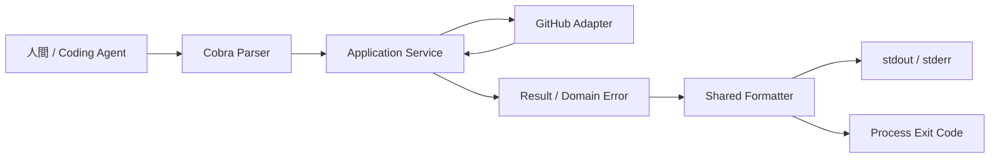
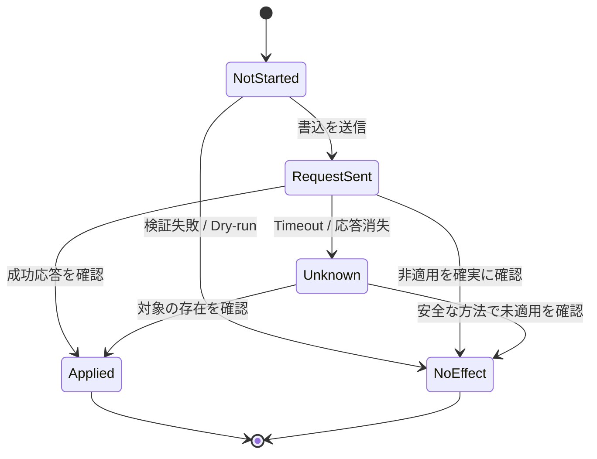
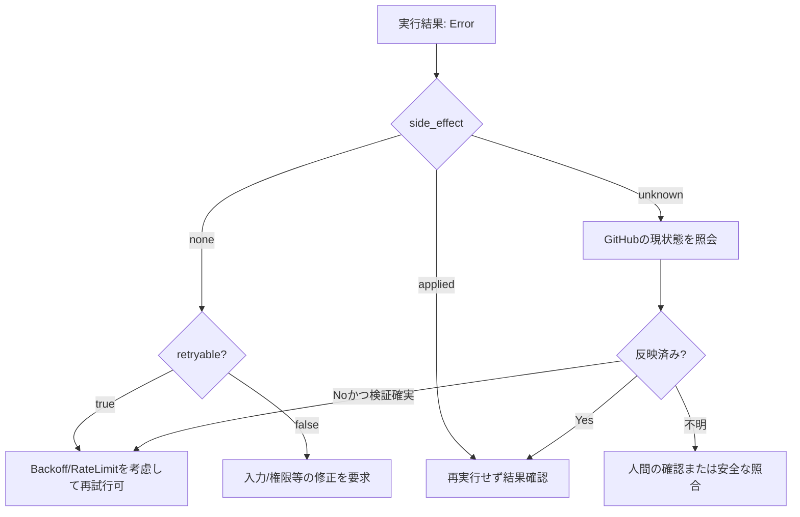
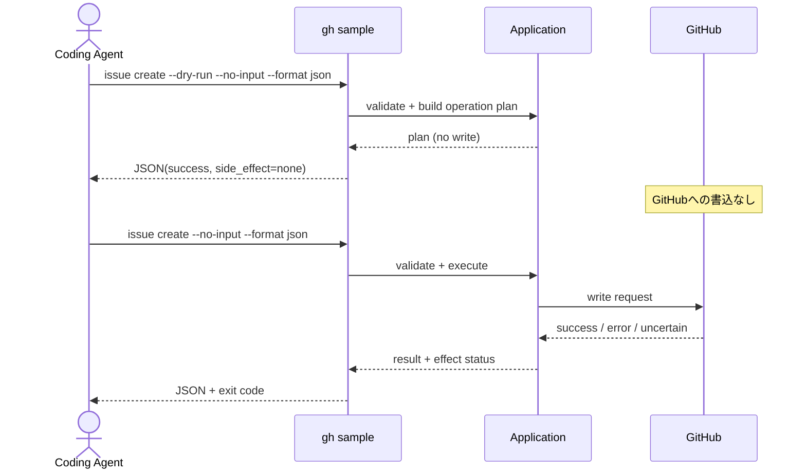
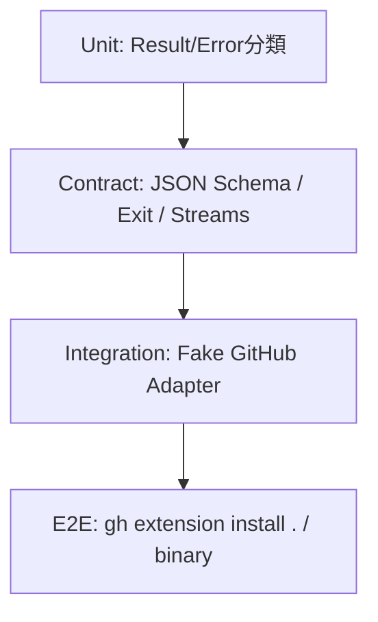

# CLI外部契約仕様: Agent-Native gh Extension Template

> Status: **Proposed contract v0.1** / 2026-10-11  
> 本書のJSON形式・Exit Code割当ては**このテンプレート独自の設計案**であり、GitHub CLI公式の共通仕様ではない。実装・契約テストの開始時に版を固定する。  
> スコープ: テンプレートから生成されるCLIの外部振る舞い。

## 1. 契約の目的

Coding Agentは自然言語の文面ではなく、構造化した識別子・型・状態に基づき次の操作を決定できなければならない。人間はTTY上で簡潔な出力を受け取れる必要がある。



### 1.1 用語

- **Public contract:** フラグ、入力条件、レスポンスSchema、終了コード、診断出力、再試行規則。
- **Result:** 操作が成功した際の結果データ。
- **Error code:** `AUTH_REQUIRED`のような安定した文字列。
- **Exit Code:** OSプロセスが返す数値。
- **Side effect:** GitHubなど外部状態の変更。
- **Retryable:** 追加の前提条件が満たされる場合を含め、技術的に再実行が可能かの分類。`true`でも安全な即時リトライを意味しない。

## 2. コマンド共通フラグ

| フラグ | 意味 | MVP |
|---|---|---|
| `--format text\|json` | 出力形式。既定は`text` | 必須 |
| `--no-input` | 対話入力を禁止 | 必須 |
| `--dry-run` | 対応する変更系コマンドの変更計画を返す | 変更系サンプルで必須 |
| `--yes` | 明示的に許される確認を省略 | 後日。権限承認まで省略しない |
| `--json <fields>` | GitHub CLI式のフィールド指定 | MVP対象外 |
| `--jq`, `--template` | JSON加工・テンプレート | MVP対象外 |

`gh`標準の `--json fields` はフィールド指定が必要な設計なので、独自JSON Envelopeを`--json`の無引数フラグとして使わない。`--format json` と `--json fields` を同時に設ける場合は、優先順位・排他条件を事前に設計し、テストする。

## 3. JSONレスポンスの正規形式

JSONモードは**単一のJSONオブジェクト+末尾改行**をstdoutに書く。シェル実行が失敗しても（実行プロセスに制御が渡っている限り）、入力不正もJSON形式で返す。panic・プロセス強制終了など、実行不能な異常は保証範囲外。

### 3.1 成功例

```json
{
  "schema_version": "1.0",
  "ok": true,
  "data": {
    "number": 42,
    "url": "https://github.com/example/repo/issues/42"
  },
  "error": null,
  "warnings": [],
  "meta": {
    "side_effect": "applied"
  }
}
```

### 3.2 失敗例

```json
{
  "schema_version": "1.0",
  "ok": false,
  "data": null,
  "error": {
    "code": "NETWORK_UNCERTAIN",
    "message": "The request outcome could not be confirmed.",
    "retryable": false,
    "suggested_action": "Query the resource state before retrying.",
    "side_effect": "unknown"
  },
  "warnings": [],
  "meta": {
    "side_effect": "unknown"
  }
}
```

**規範ルール**

1. `schema_version`は必須。
2. `ok=true`なら`error=null`、`ok=false`なら`data=null`かつ`error`は非null。
3. `warnings`は配列。警告がなくても空配列。
4. `error.code`は機械向けの安定識別子。`message`は人間向けで内容の完全一致を保証しない。
5. `side_effect`は`none`、`applied`、`unknown`のいずれか。
6. `meta.side_effect`は実行全体の結果。エラー時は`error.side_effect`と一致。
7. `retryable=true`でも`side_effect=unknown`なら、重複を防止する確認または冪等性保証なしに自動再試行してはならない。
8. JSON内の認証情報、Token、機密値は禁止。

### 3.3 JSON Schemaの核となる部分

以下は理解用の縮約Schema。実装時は`schemas/response.schema.json`として完全版を保存し、成功/失敗の条件を`oneOf`などで検証する。

```json
{
  "$schema": "https://json-schema.org/draft/2020-12/schema",
  "title": "CLI Response",
  "type": "object",
  "required": ["schema_version", "ok", "data", "error", "warnings", "meta"],
  "properties": {
    "schema_version": {"const": "1.0"},
    "ok": {"type": "boolean"},
    "data": {},
    "error": {"type": ["object", "null"]},
    "warnings": {"type": "array", "items": {"type": "string"}},
    "meta": {
      "type": "object",
      "required": ["side_effect"],
      "properties": {
        "side_effect": {"enum": ["none", "applied", "unknown"]}
      }
    }
  }
}
```

## 4. Exit CodeとError Code

### 4.1 プロセス終了コード（暫定の独自割当て）

| Exit | 分類 | 例 | Agent側の原則 |
|---|---|---|---|
| `0` | 成功 | 読取成功、dry-run成功 | 続行 |
| `1` | 一般エラー | 未分類エラー | 診断を確認 |
| `2` | 入力不正 | 必須引数不足 | 入力修正 |
| `3` | 見つからない | Repository/Issueなし | 対象再確認 |
| `4` | 認証不備 | ログイン未完了 | 認証要求 |
| `5` | 権限不足 | APIの403（権限不足） | 権限の確認 |
| `6` | 競合 | 変更済みリソース | 状態再取得 |
| `7` | Rate limit | APIのレート制限 | リセット時刻を考慮 |
| `8` | 通信/応答不確実 | タイムアウト、接続切断 | 副作用確認 |
| `9` | 内部エラー | 不変条件違反 | 人間の診断 |

> 注意: これは**テンプレート独自の割当て**。既存の`gh`全体がこの数値を保証しているわけではない。既存仕様と衝突するかリリース前に確認する。

### 4.2 エラー識別子の例

```go
type ErrorCode string

const (
    ErrInputInvalid      ErrorCode = "INPUT_INVALID"
    ErrNotFound          ErrorCode = "NOT_FOUND"
    ErrAuthRequired      ErrorCode = "AUTH_REQUIRED"
    ErrPermissionDenied  ErrorCode = "PERMISSION_DENIED"
    ErrConflict          ErrorCode = "CONFLICT"
    ErrRateLimited       ErrorCode = "RATE_LIMITED"
    ErrNetworkUncertain  ErrorCode = "NETWORK_UNCERTAIN"
    ErrInternal          ErrorCode = "INTERNAL_ERROR"
)
```

Goのエラー分類は`errors.Is`/`errors.As`等でドメイン層から伝搬し、プロセス境界でExit Codeへ変換する。Application層で`os.Exit`しない。

## 5. stdout/stderr契約

| モード | stdout | stderr | Exit |
|---|---|---|---|
| `--format json` 成功 | 成功JSON 1個 | 追加診断がある場合のみ | 0 |
| `--format json` 失敗 | 失敗JSON 1個 | 追加診断がある場合のみ | 非0 |
| `--format text` 成功 | 人間向け結果 | 必要に応じた進捗/警告 | 0 |
| `--format text` 失敗 | 原則空 | 人間向けエラーと復旧案 | 非0 |

- JSON結果と診断テキストを同じstdoutに混在させない。
- 各モードの出力にはANSI制御文字を無条件で混入させない。
- stderrの文章は機械的なパース対象にしない。
- `--help`やCobraのパースエラーは例外になりがちなので、JSONフラグの事前検出・エラールーティングをE2Eで検証する。

```bash
# 例: JSONとして成功/失敗レスポンスを検査
set +e
gh sample hello --format json --no-input > result.json 2> diagnostic.log
status=$?
set -e
jq -e '.schema_version == "1.0" and (.ok | type == "boolean")' result.json
printf 'exit=%s\n' "$status"
```

## 6. 副作用と再試行の契約

### 6.1 状態定義

| 値 | 意味 | 取るべき行動 |
|---|---|---|
| `none` | 変更していないことを確認済 | 状況に応じて安全に再実行可能 |
| `applied` | 変更が反映されたことを確認済 | 重複実行を避ける |
| `unknown` | 反映の有無を確定できない | 状態確認・照合を先に実行 |

### 6.2 状態遷移



### 6.3 再試行の判断



**重要:** `retryable`は単独でリトライを許可しない。`side_effect`、API操作の冪等性、レート制限、ユーザー承認を合わせて評価する。

## 7. Dry-runと非対話



- `--dry-run`はAPIへの**書込ゼロ**を保証する。必要に応じて読取は許可し、その有無を明記する。
- `--no-input`時に必要な確認・引数が不足する場合、ハングせず定義済みエラーにする。
- `--yes`は「安全性確認の全省略」を意味しない。
- Dry-runで示した内容と本実行の間に外部状態が変化し得るため、完全な事前保証とは表現しない。

## 8. 実装例（設計イメージ）

```go
type SideEffect string
const (
    NoEffect SideEffect = "none"
    Applied  SideEffect = "applied"
    Unknown  SideEffect = "unknown"
)

type CLIError struct {
    Code            ErrorCode  `json:"code"`
    Message         string     `json:"message"`
    Retryable       bool       `json:"retryable"`
    SuggestedAction string     `json:"suggested_action,omitempty"`
    SideEffect      SideEffect `json:"side_effect"`
}

type Meta struct {
    SideEffect SideEffect `json:"side_effect"`
}

type Response[T any] struct {
    SchemaVersion string    `json:"schema_version"`
    OK            bool      `json:"ok"`
    Data          *T        `json:"data"`
    Error         *CLIError `json:"error"`
    Warnings      []string  `json:"warnings"`
    Meta          Meta      `json:"meta"`
}
```

> 実装例は最終的なパッケージAPIの確約ではない。`data`が`null`になり得るコマンド等は型の定義を調整する。

## 9. 契約テスト仕様

### 9.1 テストレイヤ



### 9.2 最小テストセット

```text
CT-001  JSON成功: 1つの有効JSONのみstdout
CT-002  JSON失敗: 1つの有効JSONのみstdout
CT-003  Exit 2: 入力不正
CT-004  Exit 4: 認証不備
CT-005  Exit 7: Rate limit
CT-006  Exit 8: 書込タイムアウト・副作用unknown
CT-007  テキストモード失敗: 診断がstderr
CT-008  no-input: stdinを読まず即時に終了
CT-009  dry-run: 外部書込呼出回数0
CT-010  成功/失敗がSchemaに適合
CT-011  credential redaction
CT-012  go build後のbinaryとgh extensionの出力一致
```

```go
// テストの概念例。具体的なrunCLIやFakeは実装時に定義する。
func TestJSONOutputContract(t *testing.T) {
    stdout, stderr, exit := runCLI("hello", "--name", "Alice", "--format", "json", "--no-input")
    require.Equal(t, 0, exit)
    require.JSONEq(t, `{"schema_version":"1.0","ok":true,"data":{"message":"Hello, Alice"},"error":null,"warnings":[],"meta":{"side_effect":"none"}}`, stdout)
    require.Empty(t, stderr)
}
```

上記`require`は記述例。実際のテンプレートでは標準ライブラリでテストするか、テスト依存を追加するかを別途決定する。

## 10. 互換性・変更管理

- **Patch:** 文言修正など、機械的な判定に影響しない変更。
- **Minor:** 後方互換の任意フィールドや新規コマンドを追加。未知フィールドを許容するクライアント方針を推奨。
- **Major:** フィールドの削除・意味変更・Exit Code再割当て・既存フラグの意味変更。
- `schema_version`は出力形式のバージョンを示す。実装リリースのSemVerとは区別する。
- 互換性を破る変更にはADR、移行ガイド、契約テストの更新が必要。
- 出力の順序や空白に依存する利用者を増やさない。機械側にはJSONパースを推奨する。

## 11. 仕様の残課題

1. `--format json`と `gh --json fields` を両方採用する際のUXと後方互換。
2. コマンド別の`data`フィールドのSchemaの配置方法。
3. JSONモードのパースエラーをCobraの標準処理とどう統合するか。
4. `side_effect=applied`の一部成功/複数操作への拡張が必要か。
5. `suggested_action`を自然言語だけにするか、構造化アクションを追加するか。
6. Rate limitに対する`retry_after`の型と採用条件。
7. JSON Schemaの`additionalProperties`許容範囲とバージョン運用。

## 12. 参考情報

- GitHub CLI formatting: https://cli.github.com/manual/gh_help_formatting
- GitHub extension creation: https://docs.github.com/en/github-cli/github-cli/creating-github-cli-extensions
- gh-extension-precompile: https://github.com/cli/gh-extension-precompile
- 要件: [requirements.md](./requirements.md)
