# アーキテクチャ設計書: Agent-Native gh Extension Template

> Status: **Draft v0.1** / 2026-10-11  
> 対象: Go製 `gh` 拡張機能テンプレートの内部設計  
> 上位要件: [requirements.md](./requirements.md)  
> 外部契約の正本: [cli-contract.md](./cli-contract.md)

## 1. 目的と設計境界

本書は、**人間とCoding Agentの両方が開発しやすく、かつCoding Agentから安全に操作できるCLI**を実装するための責務分離を定義する。

本書は内部実装の設計案であり、外部に見えるJSON、Exit Code、フラグ、再試行規則を再定義しない。外部の振る舞いに矛盾が生じた場合は `cli-contract.md` を正本とする。

### 1.1 二つの利用者と二つの品質軸

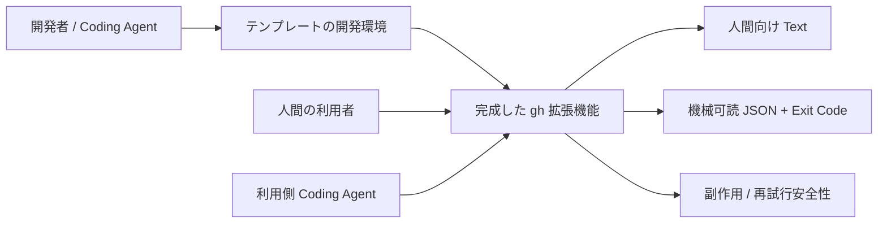

### 1.2 設計原則

1. **Contract-first:** コマンドの公開振る舞いを先に定義し、テストから実装する。
2. **Single output boundary:** stdout/stderrとプロセス終了をトップレベルで一元管理する。
3. **Thin command handler:** Cobraハンドラーは入力の受取とApplicationの呼出しに集中する。
4. **Side-effect awareness:** 書込送信後の不確実な失敗を「変更なし」と決めつけない。
5. **Dependency direction:** 内側のロジックがCobraやGitHub APIの細部に依存しない。
6. **Portable scaffold:** テンプレートから生成後、最低限の初期化だけでビルド・テスト可能。
7. **Safe by default:** 対話禁止・dry-run・診断の振る舞いを予測可能にする。

## 2. 採用技術と理由

| 対象 | 候補・採用案 | 理由と制約 |
|---|---|---|
| CLIホスト | GitHub CLI (`gh`) | 拡張機能の命名・インストール・配布フローに準拠 |
| 実装言語 | Go | 配布しやすい単体バイナリ、標準テストの充実 |
| コマンド解析 | Cobra | サブコマンド、フラグ、Helpの共通化 |
| GitHub API接続 | 小さな独自Port + Adapter | `go-gh` 等の具体ライブラリを差替可能にする |
| 出力 | Go `encoding/json` + 共通Formatter | JSONを必ず同一境界で直列化する |
| 契約 | JSON Schema Draft 2020-12 | 外部応答の変更検知に利用 |
| テスト | Go `testing` + Fake Adapter | 通常のユニットテストに外部接続を要求しない |
| リリース | `cli/gh-extension-precompile` | 公式のprecompiled拡張向け配布パターンを起点にする |

**保留:** GitHub APIアクセスを `go-gh` にするか、標準 `net/http` にするか。MVPのAPI操作が固まった時点で決定し、選定理由はADRに残す。Cobra以外のTUIフレームワークは必須にしない。

## 3. システムコンテキスト

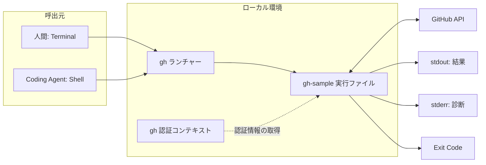

- `gh`は拡張の起動と拡張名の解決を担う。拡張自身が外部出力契約を実装する。
- 認証取得経路はAdapterに閉じ込め、トークンをResult/Formatterへ伝播しない。
- シェルによるプロセス起動自体の失敗、シグナル強制終了、panicなどは「必ずJSONになる」保証の対象外とする。

## 4. 論理アーキテクチャ

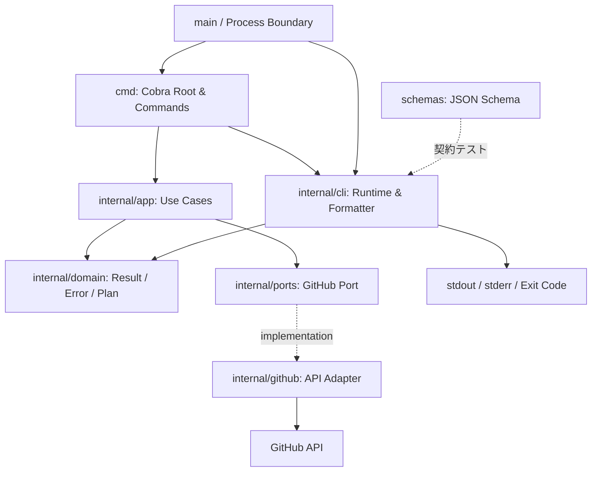

### 4.1 依存方向

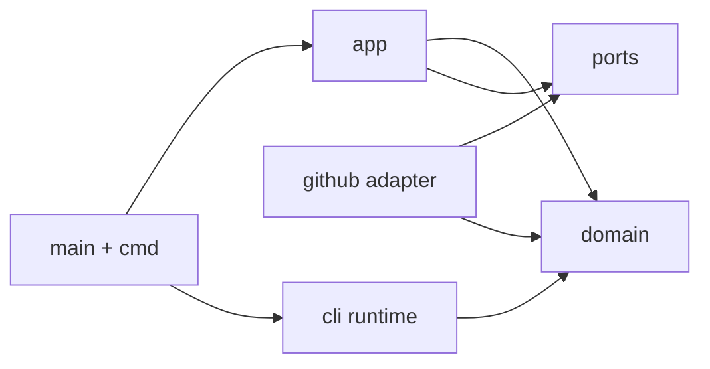

`domain` および `ports` はCobra、標準入出力、実際のGitHub APIクライアントに依存させない。`cmd`は `app` と `cli` を組み立てる外側の層とする。Goのパッケージ名と境界は実装時に調整可能だが、依存方向は維持する。

### 4.2 責務一覧

| コンポーネント | やること | やらないこと |
|---|---|---|
| `main` |依存組立て、CLI実行、最終Exit Code| API通信の業務判断 |
| `cmd` | Cobraフラグ・引数、Use Case呼出し | JSONの手動構築、`os.Exit` |
| `internal/app` | ユースケース、読取/書込の順序、Plan作成 | TTY制御、HTTPの細部 |
| `internal/domain` | Result、Error分類、SideEffect、入力モデル | CobraやHTTPレスポンス型への依存 |
| `internal/ports` | 外部GitHub操作の必要最小インターフェース | HTTP実装 |
| `internal/github` | 認証、API I/O、外部エラーの正規化 | stdoutへの直接出力 |
| `internal/cli` | 出力モード選択、レスポンス形成、Exit変換 | GitHub書込の実行 |
| `schemas` | 公開JSON形式を定義 | 実行ロジック |

## 5. 推奨リポジトリ構成

```text
.
├── cmd/
│   ├── root.go             # Cobra root作成、共通フラグ
│   ├── hello.go            # 読取のみのサンプル
│   └── issue_create.go     # dry-run対応の書込サンプル
├── internal/
│   ├── app/
│   │   ├── hello.go
│   │   └── create_issue.go
│   ├── domain/
│   │   ├── outcome.go      # side_effectを含む実行結果
│   │   ├── errors.go       # 型付きエラー
│   │   └── plan.go         # dry-runの計画
│   ├── ports/
│   │   └── github.go       # GitHub操作の抽象
│   ├── github/
│   │   ├── adapter.go
│   │   └── errors.go
│   └── cli/
│       ├── runtime.go      # Cobra実行と出力を統括
│       ├── formatter.go
│       ├── response.go
│       └── exitcode.go
├── schemas/
│   └── response.schema.json
├── test/
│   ├── contract/
│   ├── golden/
│   └── fakes/
├── docs/
│   ├── requirements.md
│   ├── cli-contract.md
│   ├── architecture.md
│   └── decisions/
├── .agents/skills/gh-extension-development/SKILL.md
├── .github/workflows/
├── AGENTS.md
├── README.md
├── go.mod
└── main.go
```

**注意:** `cmd/issue_create.go`は実際のIssue作成製品を完成させるためではなく、書込・dry-run・不確実な応答を例示するサンプルである。実GitHub APIへの書込は明示的な統合テストのみに制限する。

## 6. コマンド起動から終了まで

### 6.1 通常の実行シーケンス

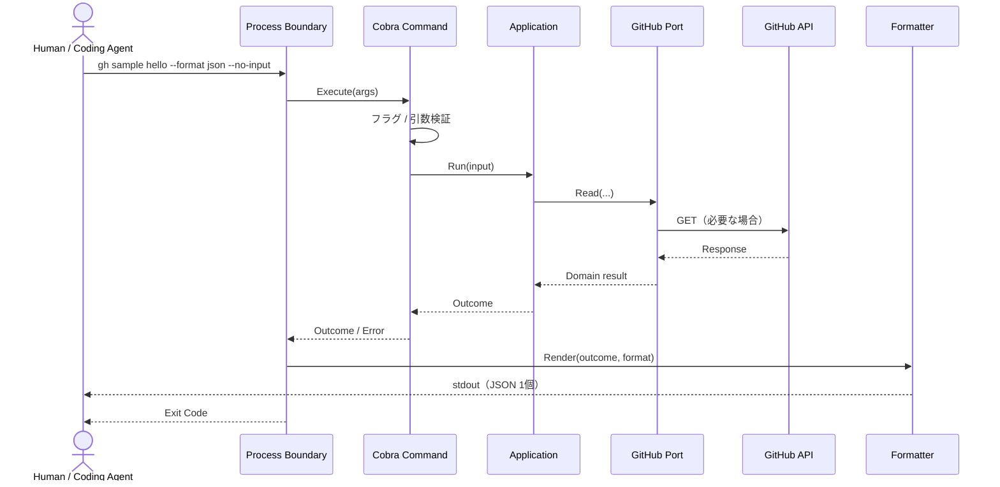

`hello`が外部APIを必要としない実装なら、Port/API部分は通らない。上図は一般的な読取ユースケースも含めた代表フロー。

### 6.2 処理状態と出力の決定

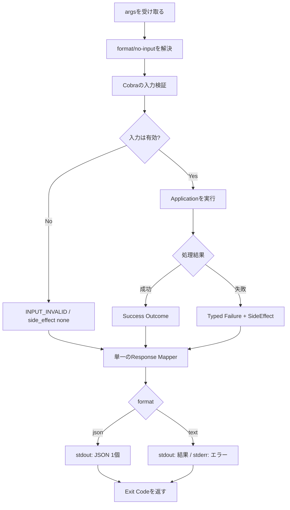

**MVP上の難所:** Cobraの引数パース失敗はハンドラー実行前に起こる。`--format json` が指定されている場合に標準エラー文が直接stdoutへ漏れたり、JSON未出力になったりしないよう、`SetOut`/`SetErr`、`SilenceUsage`/`SilenceErrors`とエラーの最終集約方針を統合テストで確認する。`--help`と不正フラグの組合せ、`--format`の指定不正、フラグ順序も検証する。

## 7. 主要なGoインターフェース（疑似設計）

以下のコードは**実装前の設計スケッチ**であり、このままコンパイルできる完全実装ではない。公開JSON形式は `cli-contract.md` を参照する。

```go
// DomainはI/OやCobraに依存しない。
type SideEffect string
const (
    NoEffect SideEffect = "none"
    Applied  SideEffect = "applied"
    Unknown  SideEffect = "unknown"
)

type AppError struct {
    Code       string
    Message    string
    Retryable  bool
    SideEffect SideEffect
    Cause      error // JSON出力しない内部診断
}

type Outcome[T any] struct {
    Value      T
    SideEffect SideEffect
    Warnings   []string
}
```

```go
// GitHub操作のPortはユースケースに必要な範囲だけ定義する。
type GitHubIssues interface {
    CreateIssue(ctx context.Context, repo string, title string) (Issue, error)
    FindIssue(ctx context.Context, repo string, marker string) (Issue, error)
}
```

```go
// mainで唯一のプロセス終了境界を保持する。
func main() {
    os.Exit(run(os.Args[1:], os.Stdout, os.Stderr))
}

// runでは依存を組み立て、実行結果を必ず一度だけ描画する。
// この関数の型・戻り値は例示で、実際のRoot作成APIは別途設計する。
```

- JSONは `encoding/json.Encoder` による単一回のエンコードを基本とする。
- `meta.side_effect` は成功・失敗とも必須とし、失敗時は `error.side_effect` と一致させる。
- 未分類エラーは内部情報をそのまま露出せず、安定した公開コードに変換する。
- `errors.Is` / `errors.As` による型判定を優先し、文字列一致で分類しない。
- **HTTPエラーの種類だけで副作用状態を決めない。** 書込リクエスト送信後のタイムアウトは `unknown` になり得る。

## 8. Dry-run / 書込 / 不確実な完了

### 8.1 dry-runの実行モデル

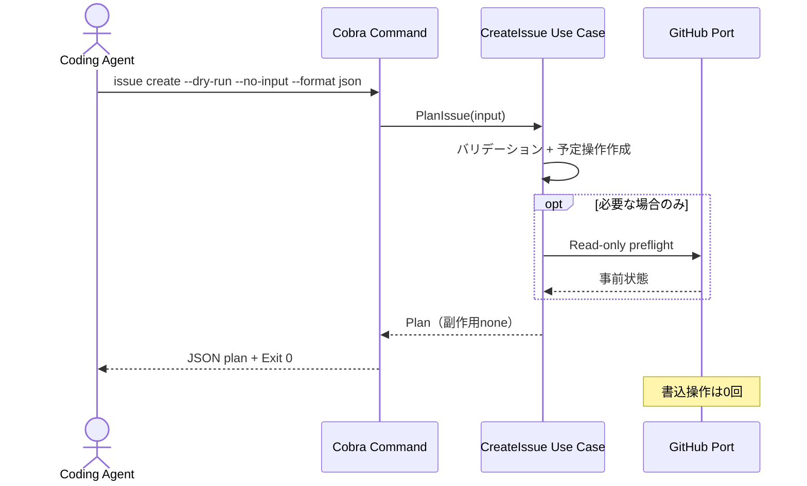

- dry-runと実行処理は**同じ入力検証ルール**を使う。
- `PlanIssue` は書込Portのメソッドを呼べない構造が望ましい。少なくともテストで書込呼出し回数0を保証する。
- 外部状態の変化があるため、dry-runは「後続の本実行が必ず成功する」ことを保証しない。

### 8.2 送信済み書込の結果が不明なケース

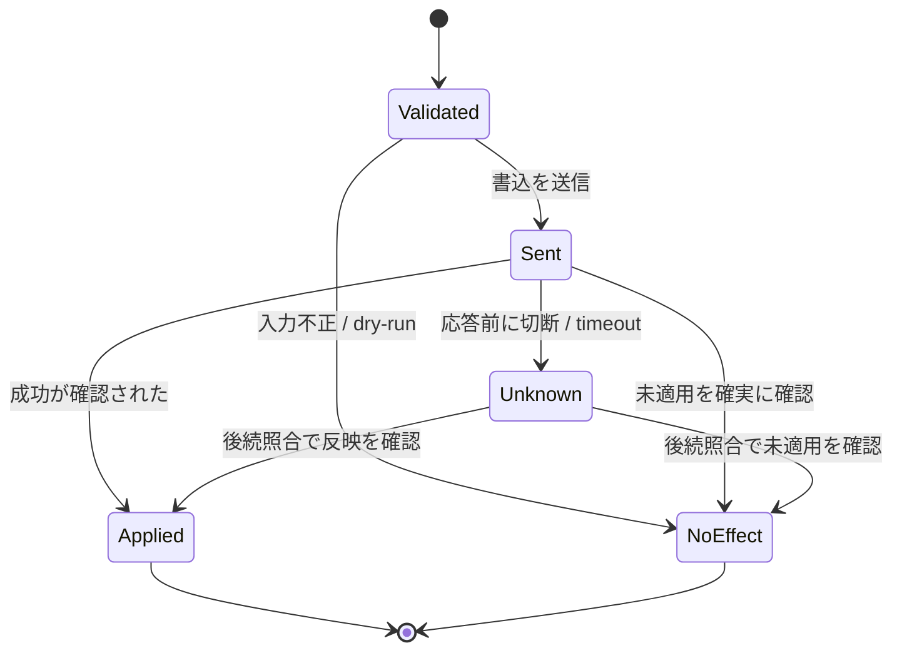

`Unknown` は単なる通信エラーと区別する。APIの再試行ポリシーはApplicationが決定し、Adapterは通信状況と取得できた証拠を報告する。テンプレートのMVPでは非冪等な書込の自動リトライを実装しない。

### 8.3 リトライ判断の境界

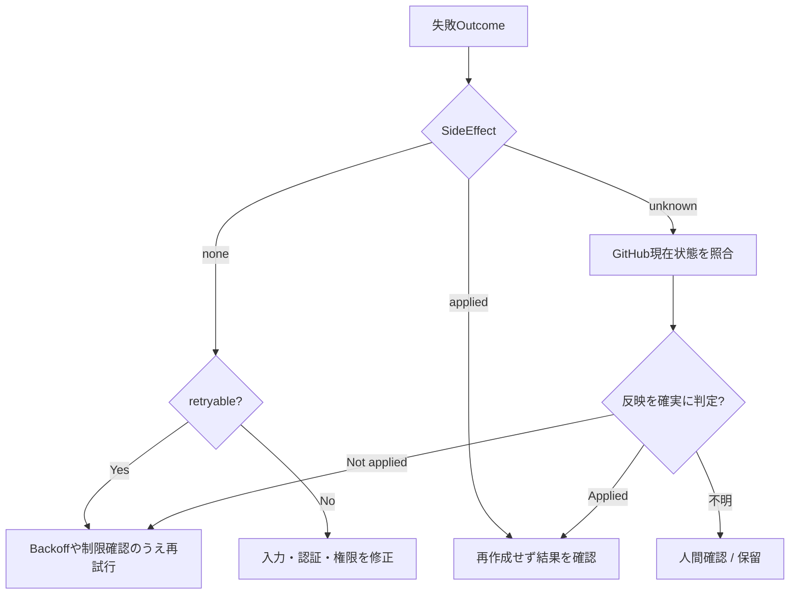

## 9. 外部エラーからCLI応答への変換

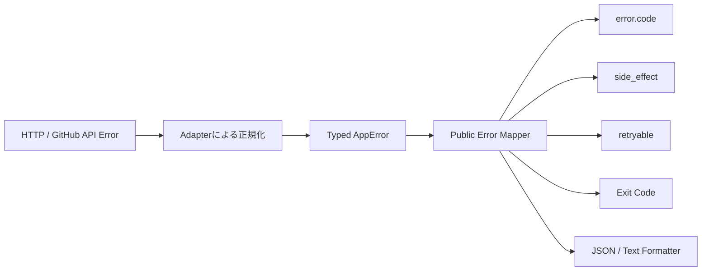

参照対応表（**数値は `cli-contract.md` の暫定案に追従**）:

| 分類 | Error Code例 | Exit | 補足 |
|---|---|---:|---|
| 不正な入力 | `INPUT_INVALID` | 2 | API呼出し前、通常 `none` |
| リソース不在 | `NOT_FOUND` | 3 | 書込を送っていない場合 `none` |
| 認証欠落 | `AUTH_REQUIRED` | 4 | Tokenの出力は禁止 |
| 権限不足 | `PERMISSION_DENIED` | 5 | GitHub 403すべてを同一分類にしない |
| 競合 | `CONFLICT` | 6 | 必要なら再取得 |
| 制限超過 | `RATE_LIMITED` | 7 | 二次レート制限も考慮 |
| 応答不確実 | `NETWORK_UNCERTAIN` | 8 | 書込送信後は `unknown` の可能性 |
| 内部不具合 | `INTERNAL_ERROR` | 9 | 内部詳細を結果JSONへ出さない |

HTTPステータスのみから機械的に分類してはいけない。特に403は権限不足とレート制限の両方で発生し得るため、レスポンス情報と処理文脈を加味する。

## 10. 出力の責務とパースエラー対策

### 10.1 出力チャネル

| レイヤ | stdout | stderr | Process Exit |
|---|---|---|---|
| `app / domain / github` | 書き込まない | 書き込まない | 呼ばない |
| `cmd` | 原則書き込まない | 原則書き込まない | 呼ばない |
| `cli runtime` | 成功/失敗レスポンス | 必要な診断 | Exitに対応する値を返す |
| `main` | formatterへ委譲 | formatterへ委譲 | `os.Exit`を一度だけ呼ぶ |

### 10.2 JSONモードの保証

- 処理成功でも失敗でも **単一JSONオブジェクト＋末尾改行**。
- `warnings` が空の場合は `[]`、`error` がない場合は `null`。
- 実行結果のJSONはstdoutに限定し、stderrテキストをパース要件に含めない。
- `--format json` の指定を引数エラー発生時にも扱えるようにする。形式の指定すら壊れているときの既定動作は契約実装の初期段階で固定する。
- Cobraのhelp/versionは通常の結果コマンドと別の動作なので、JSON強制範囲を明示する。MVPではhelp/versionのJSON化は対象外とする案を推奨する。

## 11. テスト設計

### 11.1 テストピラミッド

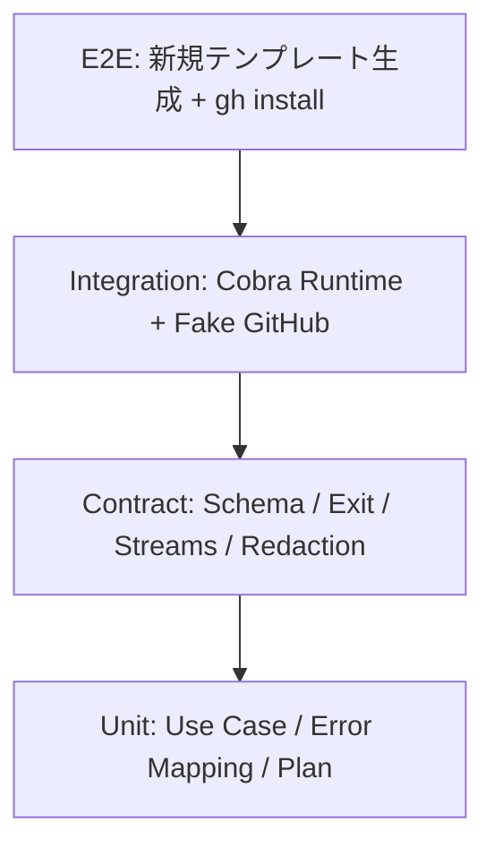

### 11.2 要件とテストの対応

| テスト対象 | テスト例 | 検証手法 |
|---|---|---|
| 出力契約 | 成功・失敗JSONは1オブジェクト | JSON Decoder + EOF確認 |
| Schema | 必須項目と相互排他の検証 | JSON Schema validator |
| Exit Code | 入力2、認証4、通信不確実8 | CLIプロセス/Runの結果検証 |
| ストリーム | stdoutにログが混ざらない | 独立バッファで比較 |
| 非対話 | stdinが閉じても停止せず入力不足を返す | timeout付き実行テスト |
| dry-run | GitHub Portの書込ゼロ | Fakeの呼出し履歴を検証 |
| 副作用 | 送信後timeoutで `unknown` | Fakeの注入エラー |
| 情報漏えい | Tokenがstdout/stderrにない | スナップショット/文字列検査 |
| 新規拡張 | 初期化後にビルド可能 | 一時ディレクトリでE2E |

### 11.3 契約テストの疑似コード

```go
func TestJSONContract(t *testing.T) {
    // runCLIはFake Adapterを使ってstdout/stderr/exitを回収するテストヘルパー。
    stdout, stderr, exit := runCLI("hello", "--format", "json", "--no-input")
    if exit != 0 { t.Fatalf("unexpected exit: %d, stderr=%s", exit, stderr) }

    var decoded map[string]any
    dec := json.NewDecoder(strings.NewReader(stdout))
    if err := dec.Decode(&decoded); err != nil { t.Fatal(err) }
    if err := dec.Decode(new(any)); err != io.EOF {
        t.Fatalf("expected one JSON value, got: %v", err)
    }
    // response.schema.jsonによるSchema検証も行う。
}
```

上記は設計上の例であり、`runCLI` やSchemaバリデータの具体的な実装はテストセットアップ時に決める。

## 12. CI・リリース・テンプレート生成

```mermaid
flowchart LR
    Template["GitHub Template"] --> Init["名前 / Moduleの初期化"]
    Init --> Test["Go build / test / vet / lint"]
    Test --> Contract["CLI Contract Tests"]
    Contract --> Review["Pull Request Review"]
    Review --> Release["Tag / precompile Release"]
    Release --> Install["gh extension install"]
    Install --> Smoke["stdout / JSON / Exit E2E"]
```

### 12.1 CIの最低限のジョブ

1. `gofmt`の差分確認。
2. `go vet ./...`。
3. `go test ./...`（ユニット＋契約）。
4. `go build ./...`。
5. `golangci-lint`（設定とツールのバージョンを固定した後）。
6. テンプレート初期化後のスモークテスト（MVP完了時に必須）。

### 12.2 テンプレートから生成後の流れ

```bash
# リポジトリ作成（例。テンプレート所有者と名前は置換する）
gh repo create gh-my-tool --template OWNER/gh-agent-template --public --clone
cd gh-my-tool

# 以降の初期化CLIは実装後の確定手順に従う。
# READMEに存在しないコマンドを「利用可能」として案内しない。
```

リリースWorkflowではビルド成果物の対象OS/architecture、チェックサム、タグ・バイナリ名の整合を検証する。実機E2Eで `gh extension install .` が利用できることを確認する。

## 13. セキュリティと運用

- 認証情報はAdapter境界より外へ出さない。診断メッセージにも生値を含めない。
- GitHub API操作の対象Repositoryを明示的に解決し、意図しないRepositoryへの変更を防ぐ。
- 非対話フラグは黙ってユーザー確認を突破するためのものではない。承認が必要なら失敗として呼出元に伝える。
- Logging/Tracing導入は任意。JSON結果のstdoutを汚さないことを最優先とする。
- エラーの文字列表現は安定APIではない。AgentはExit Code・error.code・side_effectに依存する。

## 14. 設計判断と実装作業の追跡

未決定の設計判断は Go/Cobra [#2](https://github.com/UtakataKyosui/gh-extension-template/issues/2)、出力契約・版管理 [#1](https://github.com/UtakataKyosui/gh-extension-template/issues/1)、GitHub Adapter・書込安全性 [#5](https://github.com/UtakataKyosui/gh-extension-template/issues/5)、パースエラー [#4](https://github.com/UtakataKyosui/gh-extension-template/issues/4)、JSON互換 [#13](https://github.com/UtakataKyosui/gh-extension-template/issues/13) で追跡する。確定した重要な判断は `docs/decisions/` にADRとして記録する（現時点では未作成）。

実装順序・依存関係・検証成果物は[READMEのIssue一覧](../README.md#work-tracking)から参照する。本書は内部構造と責務の正本とする。

---

### 参考資料

- [GitHub CLI Extension Documentation](https://docs.github.com/en/github-cli/github-cli/creating-github-cli-extensions)
- [GitHub CLI Manual](https://cli.github.com/manual/)
- [Cobra](https://github.com/spf13/cobra)
- [gh-extension-precompile](https://github.com/cli/gh-extension-precompile)
- [要件定義書](./requirements.md)
- [CLI外部契約](./cli-contract.md)
