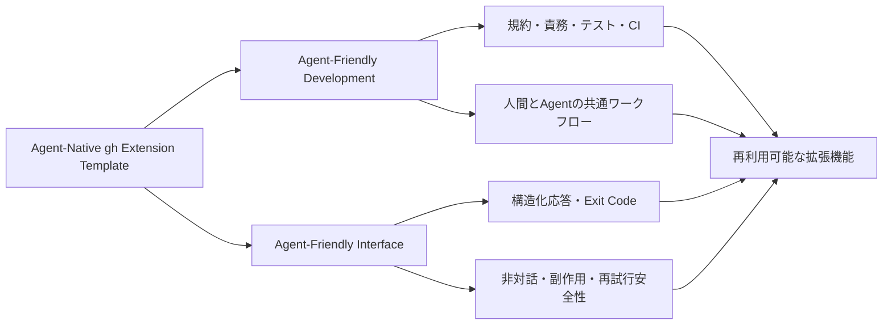
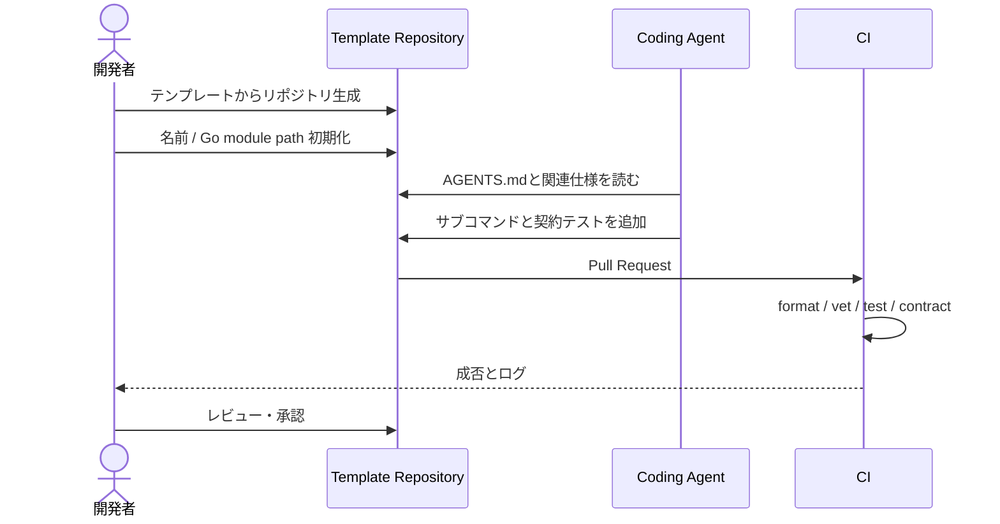
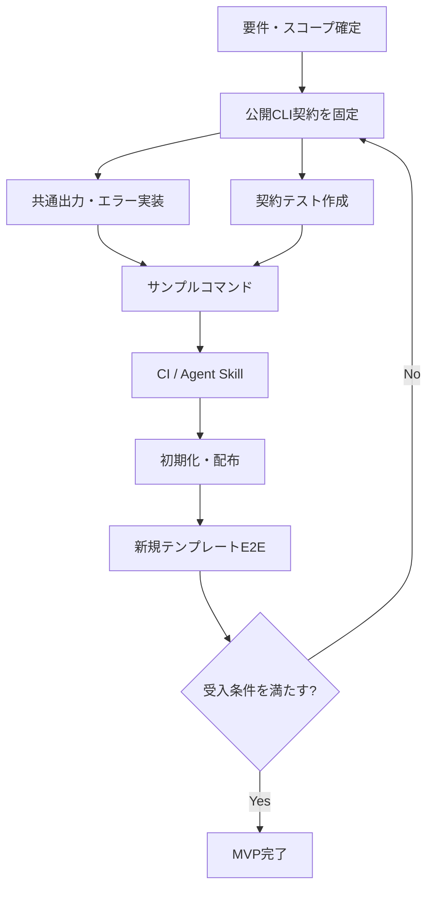

# 要件定義書: Agent-Native gh Extension Template

> Status: Draft v0.1 / 2026-10-11  
> 対象: Go製GitHub CLI拡張機能のテンプレート  
> 正本: 本書は「何を満たすか」、[CLI契約](./cli-contract.md)は「どのように外部へ見せるか」を規定する。

## 1. 背景と目的

GitHub CLI (`gh`) の拡張機能を新規作成する際、Goの雛形、CI、リリース、テスト、Agent向けルール、機械可読な出力仕様を毎回作り直す負担がある。公式の `gh extension create --precompiled=go` はGoスターターとワークフローを生成できるが、CLIがCoding Agentから安全に利用されるための契約を一式定義するものではない。

**目的:** 人間とCoding Agentの双方にとって、開発しやすく、呼び出しやすく、検証しやすい `gh` 拡張機能を作成できるGitHub Template Repositoryを提供する。

**本プロジェクトが提供するのは「拡張機能の雛形」であり、Issue/PRの自動生成ツールそのものではない。** そのようなツールは本テンプレートから作成する下流プロジェクトとする。

### 1.1 二つの品質軸



## 2. 想定利用者とユースケース

| ID | 利用者 | ユースケース | 期待される結果 |
|---|---|---|---|
| UC-01 | 人間の開発者 | テンプレートから新規 `gh-*` リポジトリを作る | 最小限の置換だけでビルド・起動できる |
| UC-02 | Coding Agent（開発側） | 新規サブコマンドを追加する | 構造・規約・テストを発見し実装できる |
| UC-03 | 人間の利用者 | TTYで拡張機能を実行する | 読みやすい結果・適切な診断情報が表示される |
| UC-04 | Coding Agent（利用側） | CLIを非対話で実行する | パース可能な結果と確定した終了状態を受け取れる |
| UC-05 | Coding Agent（利用側） | APIタイムアウトに遭遇する | 再試行可能性と副作用の不確実性を区別できる |
| UC-06 | 維持管理者 | 新しいバージョンを配布する | 契約テストを通ったバイナリをリリースできる |

### 2.1 代表的な操作シナリオ



## 3. スコープ

### 3.1 MVP（Must）

1. Goによるprecompiled `gh` 拡張機能の実行基盤。
2. Cobraベースのルート・サンプルサブコマンド。
3. 共通レスポンス層（人間向けテキスト / JSON）。
4. 安定したエラー識別子、終了コード、stderr/stdoutの規則。
5. 非対話実行を妨げない設計。対話が必要なら機械可読に失敗する。
6. 副作用の状態（`none` / `applied` / `unknown`）と再試行可否の表現。
7. `--dry-run`をサポートする**副作用付きサンプルコマンド**、または安全なFakeによる同等の契約テスト。
8. Go単体テスト・契約テスト・ビルド・Lintを実行するCI。
9. `AGENTS.md`、要件・契約・設計資料、少なくとも一つのAgent Skill。
10. 名前置換と検証を含むテンプレート初期化手順。
11. `gh extension install .` によるローカル動作確認、precompiledリリースの雛形。

### 3.2 Post-MVP（Should / Could）

- `manifest --format json` による機械可読なコマンド能力の公開。
- GitHub CLI流の `--json fields` / `--jq` / `--template` の明示的な互換レイヤー。
- コマンド自動ドキュメント生成。
- 多段の対話UIやTUIのオプション対応。
- 多数のGitHub API操作例、プラグイン拡張機構。

### 3.3 Non-goals（MVP対象外）

- 汎用のAgent実行エンジン、MCPサーバー、バックグラウンド常駐プロセスの提供。
- Issue/PR本文自動生成の完成品を作ること。
- すべてのGitHub CLIコマンドと出力互換になること。
- 全APIの重複実行防止を自動的に保証すること。
- Windows/macOS/Linux以外も含めた無制限の配布保証。

## 4. 機能要件

各要件にはテスト可能な受入条件を付与する。`M`=MVP必須、`P`=MVP後。

| ID | 優先 | 要件 | 受入条件 |
|---|---|---|---|
| FR-01 | M | `gh-*`としてインストール・呼出可能 | 新規生成したリポジトリでビルド、ローカルインストール、サブコマンド起動が成功 |
| FR-02 | M | 出力形式選択 | `--format text`と`--format json`を区別し、JSONが機械的にパース可能 |
| FR-03 | M | 共通成功/失敗モデル | 全サンプルコマンドが同一のレスポンス契約を満たす |
| FR-04 | M | Exit Code分類 | 仕様で定義した条件ごとにコードが一意に決まる |
| FR-05 | M | Error分類 | エラー識別子が安定し、`retryable`と`side_effect`が含まれる |
| FR-06 | M | ストリーム分離 | JSONモードでstdoutには結果JSONのみ。診断はstderrへ |
| FR-07 | M | 非対話モード | `--no-input`で対話待ちしない。必要な入力欠落時は失敗 |
| FR-08 | M | Dry-runの基準 | 対応コマンドでは予定操作を返し、外部への書込を行わない |
| FR-09 | M | API依存の分離 | 外部APIなしでエラー・成功・曖昧失敗をテストできる |
| FR-10 | M | CI | PRでビルド、format、vet、ユニット、契約テストが動作 |
| FR-11 | M | Template初期化 | 名称・Go moduleの置換後に`go test ./...`が成功 |
| FR-12 | M | Agent向け作業規則 | AGENTS.mdとSkillに追加コマンド・検証手順が明記 |
| FR-13 | M | 公開契約の版管理 | スキーマ版と互換性ルールが文書化されている |
| FR-14 | P | Command manifest | 能力・フラグ・副作用のメタデータを機械可読に公開 |
| FR-15 | P | JSONフィールド投影 | `gh --json fields`との連携方針に基づき任意フィールドを選択可能 |

## 5. 非機能要件

| ID | 要件 | 確認方法 |
|---|---|---|
| NFR-01 | **予測可能性**: 同一条件ではレスポンス形と終了コードが一致 | contract/golden tests |
| NFR-02 | **安全性**: 不明な完了状態を確実な失敗として扱わない | timeout injection test |
| NFR-03 | **セキュリティ**: アクセストークン・機密情報をログ/JSONに出さない | redaction tests, code review |
| NFR-04 | **保守性**: PresentationとGitHub API呼び出しを分離 | package dependency review |
| NFR-05 | **可搬性**: 公式precompileの対象環境で動作可能 | release builds + smoke tests |
| NFR-06 | **拡張性**: 新規コマンドを共通出力層の変更なしに追加可能 | sample second command test |
| NFR-07 | **利用容易性**: テンプレート利用者が手順に従って初期化可能 | fresh-template E2E |
| NFR-08 | **ドキュメント一貫性**: 要件/契約/実装の不整合を検出 | PR checklist / contract tests |

> 性能の具体的な数値SLOは未設定。測定前の根拠のない数値保証は行わない。

## 6. サンプルコマンドと受入テスト

MVPには副作用のない `hello` と、Fake GitHub APIを使う副作用付き `issue create`（実APIへの書込は統合テスト専用）の二つの経路を用意することを推奨する。コマンド名は開発初期の仮称であり、正式名称は設計時に固定する。

```bash
# 人間向け（例）
gh sample hello --name Alice

# Coding Agent向け（例）
gh sample hello --name Alice --format json --no-input

# dry-run: 書込を行わず予定操作を返す（例）
gh sample issue create --title "Fix parser" --dry-run --format json --no-input
```

### 6.1 BDD形式の受入条件

```gherkin
Feature: 機械可読なCLI応答
  Scenario: 成功したJSONモードのコマンド
    Given 入力が正しい
    When --format json --no-input でコマンドを実行する
    Then stdoutはちょうど1個のJSONオブジェクトとしてパース可能
    And レスポンスは公開Schemaに適合する
    And Exit Codeは0

  Scenario: GitHub API呼出の完了状態が不明
    Given 非冪等な書込が送信された
    And APIの応答前に通信が途絶えた
    When コマンドが失敗応答を生成する
    Then error.side_effectは"unknown"
    And 無条件な自動再試行を推奨しない
```

### 6.2 検証マトリクス

| ケース | JSON | Exit | side_effect | 外部書込 |
|---|---|---|---|---|
| 正常な読取 | 妥当 | 0 | `none` | なし |
| 入力不備 | 妥当 | 2 | `none` | なし |
| 認証失敗 | 妥当 | 4 | `none` | なし |
| Dry-run | 妥当 | 0 | `none` | なし |
| 書込成功 | 妥当 | 0 | `applied` | あり |
| 書込後の応答ロスト | 妥当 | 8 | `unknown` | 不明 |

## 7. 要件の依存関係



## 8. Definition of Done

- [ ] FR-01〜FR-13の各受入条件を満たす。
- [ ] `--format json`の成功・失敗パスの契約テストが通る。
- [ ] stdout/stderr混入のないことを自動テストで確認する。
- [ ] 書込成功、失敗、結果不明を区別するテストがある。
- [ ] ローカル実行と新規テンプレートからのE2Eを検証する。
- [ ] 秘密情報の非出力を確認する。
- [ ] `README.md`、`AGENTS.md`、`cli-contract.md`と実際の実装が一致する。
- [ ] CIが緑であり、リリースの手順が再現可能である。

## 9. 未決定事項・変更管理

| 論点 | 暫定判断 | 決定タイミング |
|---|---|---|
| サンプルコマンド名 | `hello`, `issue create`（仮） | Cobra導入前 |
| GitHub APIクライアント | `go-gh` または分離したAPI adapter | architecture確定時 |
| `--json fields`互換 | MVP外。`--format json`を使用 | Post-MVP |
| JSON Schemaバージョン | 契約v1としドキュメントで管理 | contract実装時 |
| Rate-limit retry | 自動再試行はMVP外 | Post-MVP |
| プラットフォーム行列 | 公式precompileを基準に検証 | CI実装時 |

公開契約への変更では仕様・schema・テスト・変更履歴を同時に更新する。破壊的変更はレビューを必須とする。

## 10. 参考資料

- GitHub Docs: https://docs.github.com/en/github-cli/github-cli/creating-github-cli-extensions
- GitHub CLI formatting: https://cli.github.com/manual/gh_help_formatting
- gh-extension-precompile: https://github.com/cli/gh-extension-precompile
- CLI契約: [cli-contract.md](./cli-contract.md)
