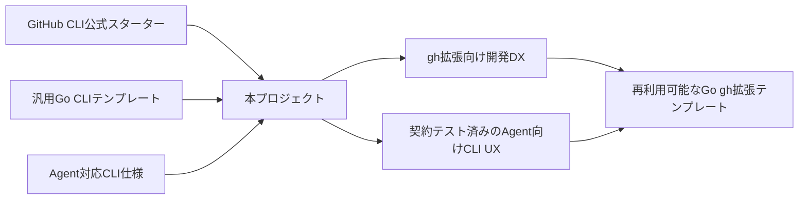
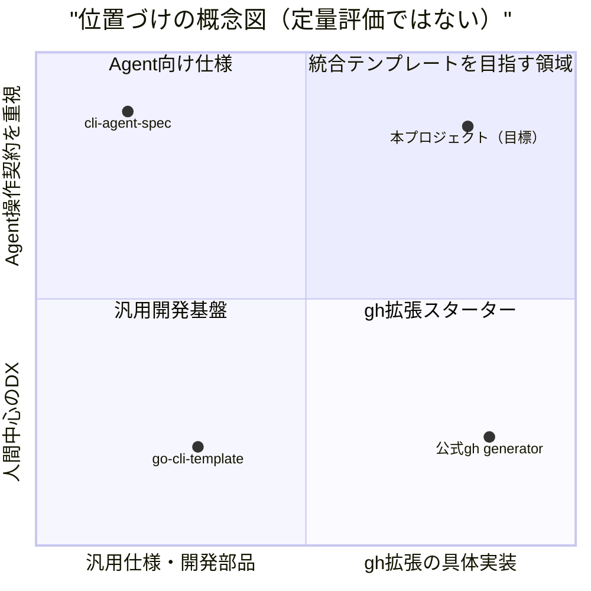
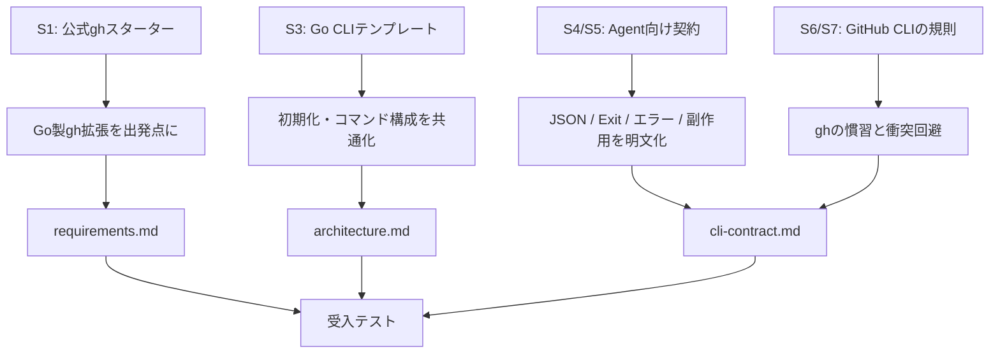
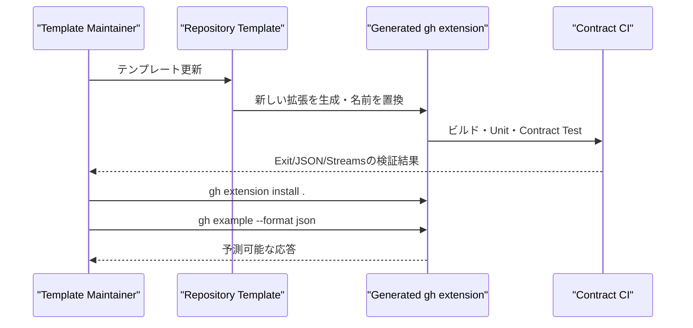

# 先行調査・設計根拠・差別化分析

> Status: Research / Proposed v0.1  
> 調査基準日: 2026-10-11  
> 位置づけ: **設計の根拠と競合・参考資料の記録**。本書は規範仕様ではない。確定したCLI挙動は [`cli-contract.md`](./cli-contract.md)、要求は [`requirements.md`](./requirements.md)、内部構成は [`architecture.md`](./architecture.md) を正本とする。

## 1. 調査目的と背景

このプロジェクトは、GitHub CLI (`gh`) 拡張をGoで始める際の初期構成の繰り返し作業を減らすことから始まった。しかし議論の過程で、単にCoding Agentが**開発しやすい**だけでは足りず、完成したCLIをCoding Agentが**安全に操作・解釈できる**ことが重要だと明確になった。

そのため、本プロジェクトは次の二軸を統合する。

- **Agent-Friendly Development (DFX):** 構造・指示・テスト・CI・リリースが整備され、人とAgentが変更しやすい。
- **Agent-Friendly Interface (AX):** 出力・終了コード・エラー・副作用・非対話動作が契約化され、Agentが次の行動を判断しやすい。



## 2. 一次資料・比較対象

以下の記述は、2026-10-11に公開ページで確認した範囲に限定する。リポジトリの存在やREADMEの機能説明だけで、すべての機能が完成・検証済みだとは判断しない。

| ID | 名称・一次資料 | 確認できた特徴 | 本プロジェクトとの関係 |
| --- | --- | --- | --- |
| S1 | [GitHub CLI: `gh extension create`](https://cli.github.com/manual/gh_extension_create) / [公式作成ガイド](https://docs.github.com/en/github-cli/github-cli/creating-github-cli-extensions) | `--precompiled=go` によるGo用スターター・Workflow | gh拡張生成の**ベースライン** |
| S2 | [cli/gh-extension-precompile](https://github.com/cli/gh-extension-precompile) | GitHub Actionsを使ったビルド・リリース自動化 | 配布の既存仕組みを**再利用** |
| S3 | [imdevan/go-cli-template](https://github.com/imdevan/go-cli-template) | Cobra、Bubble Tea、テスト、just、メタデータ同期、文書生成 | Go CLIのDX・初期化処理を**参考** |
| S4 | [cli-agent-spec/cli-agent-spec](https://github.com/cli-agent-spec/cli-agent-spec) / [実装ガイド](https://github.com/cli-agent-spec/cli-agent-spec/blob/master/IMPLEMENTING.md) | Exit Code、共通レスポンス、Manifest、失敗パターン、検証方針・適合性ツール | AXの**主要な参考仕様** |
| S5 | [javimosch/cli-output-spec](https://github.com/javimosch/cli-output-spec) | stdout/stderr、意味ある終了コード、構造化エラー、機械可読Help、Agent Skill | 軽量出力契約の**比較対象** |
| S6 | [GitHub CLI拡張の仕様](https://cli.github.com/manual/gh_extension) / [ローカルインストール](https://cli.github.com/manual/gh_extension_install) | `gh-`という命名、実行ファイル、引数委譲、ローカルインストール | **互換性・E2Eの前提** |
| S7 | [GitHub CLI help reference](https://cli.github.com/manual/gh_help_reference) | 一部のghコマンドに`--json fields`、`--jq`、`--template`がある | CLI出力フラグの**整合性検討** |

### 比較対象についての注意

- `cli-agent-spec`は2026-10-11時点の公開READMEで、複数の失敗モード・要件・Schema・適合性検証を提供している。数値は改訂され得るため、本資料の差別化根拠に固定数を用いない。
- `cli-output-spec`もAgent向けのルールや実装例を提供している。**「Agent向けCLI契約を最初に提唱した」ことは本プロジェクトの独自性ではない**。
- 「GitHubに類似テンプレートが存在しない」と断定しない。調査対象と比較軸を明示して、確認できた範囲で評価する。
- 各プロジェクトのREADMEに記載がない機能は「未確認」と表記し、「非対応」と断定しない。

## 3. 何を継承し、何を独自に構築するか

| 設計領域 | 参照元 | 採用・変更方針 | 独自の実装・検証ポイント |
| --- | --- | --- | --- |
| gh拡張の生成 | S1 | 公式生成形態に整合 | 一度で再利用可能なGitHub Templateへの初期化 |
| ビルド・公開 | S2 | 公式Actionを優先利用 | Template複製後の名前・module整合性検証 |
| Go CLI構成 | S3 | Cobraと責務分離を参考 | gh拡張向けAdapter・共通CLI Runtimeを組込む |
| Agent向け出力 | S4, S5 | 考え方を参照し、独自契約を明文化 | 契約に沿うGo型、Formatter、JSON Schema、Golden Test |
| Exit Codeとエラー | S4, S5 | **数値体系はコピーせず独自v0.1として設計** | 一貫したExit↔Error対応表と契約テスト |
| 副作用・再試行 | S4 | 状態検証の必要性を反映 | `none / applied / unknown` と安全な再試行条件を明文化 |
| 対話制御 | S4, S5 | 非対話モード、dry-runを採用候補に | stdinなしのE2E、誤った副作用防止テスト |
| 自己記述 | S4, S5 | Manifestは段階導入を検討 | gh拡張固有コマンド情報の表現と検証 |
| Agentが開発するための規則 | S3, S4等 | `AGENTS.md`、Skillsという既存の仕組みを利用 | 新規コマンド実装手順と契約テストの一体化 |

### 意図的に同一視しないもの

- `cli-agent-spec`に**適合していると主張しない**。そのように名乗るには特定バージョンと検証結果が必要。
- `cli-output-spec`互換とは**主張しない**。同仕様のExit Code帯やエラー形状と、現在の`cli-contract.md`案には相違がある。
- GitHub CLI公式の拡張機能仕様と、本テンプレート独自のJSONレスポンス仕様は区別する。
- フォークやソースコードコピーを前提としない。実装を再利用する場合は依存関係・ライセンス・帰属表示を別途確認する。

## 4. 差別化の仮説

**価値提案:** 「Goでgh拡張を最速で開始できる」だけでも「Agent向けCLIの仕様書」だけでもなく、**両者を接続し、仕様に準拠する拡張機能を実装・検証・公開するまでの一貫したスターターキット**を提供する。

| 比較軸 | 公式gh生成 S1 | 汎用Go CLI S3 | CLI Agent Spec S4 | 本テンプレートが目指す状態 |
| --- | --- | --- | --- | --- |
| gh専用セットアップ | 対応 | 汎用CLI | 仕様中心 | 対応 |
| Goコマンド骨格 | 対応 | 対応 | 言語非依存 | 対応 |
| Agent向け公開契約 | 本調査では未確認 | 本調査では未確認 | 対応 | 採用範囲を実装 |
| Go実装と契約テストがセット | 本調査では未確認 | 本調査では未確認 | 検証ツール・指針あり | gh拡張としてE2Eまで統合 |
| Agent向け開発規約 | 本調査では未確認 | 本調査では未確認 | 実装ガイド等あり | AGENTS / Skill / CIを同梱 |
| Template複製→リリースの一貫検証 | 本調査では未確認 | 一部機能あり | 範囲外 | 受入条件として検証 |

**注意:** 右端は**目標状態**であり、現在の実装済み機能ではない。比較は公開説明を元にした暫定評価であり、コード監査による完全な機能比較ではない。



この図は**定性的な設計上の位置づけ**を可視化したもの。数値は測定値ではなく、優劣や市場占有率を意味しない。

## 5. 設計判断の追跡



| 判断ID | 背景・根拠 | 現時点の判断 | 状態 |
| --- | --- | --- | --- |
| D-001 | S1/S2 | Go製gh拡張と公式リリースActionを基本線にする | 提案 |
| D-002 | S3 | Cobra、共通コマンド実装、初期化処理を採用候補とする | 提案 |
| D-003 | S4/S5 | JSON Envelope、意味あるError、Exit Code、stdout分離を採用する | 提案 |
| D-004 | S7 | `--json fields`と競合させないため、MVPで`--format json`を設ける | `cli-contract.md` v0.1案 |
| D-005 | S4 | `retryable`のみでなく`side_effect`を再試行判断に利用する | `cli-contract.md` v0.1案 |
| D-006 | S3/S4 | AGENTS.mdとSkillを実装ワークフローに組み込む | 提案 |
| D-007 | S4 | 特定の外部仕様への適合宣言を急がず、まず自前の契約テストを固定する | 提案 |

確定時は `docs/decisions/` にADRを起こし、採用した外部仕様の**版・コミットSHA**と理由、棄却案、移行影響を記載する。

## 6. 技術的差分の具体例

### 6.1 通常のGo CLIスターターに追加するテスト

```bash
# 将来の検証コマンドの例。まだ実装済みとは限らない
make check
./gh-example hello --format json --no-input | jq -e '.ok == true'
./gh-example issue create --dry-run --format json --no-input
```

このテンプレートでは、コマンド実装が動くことだけでなく、以下もテスト対象にする。

```gherkin
Feature: Agent-safe CLI contract
  Scenario: API request times out after a write may have succeeded
    Given GitHub may have accepted the write
    When the CLI reports a timeout
    Then the error side_effect is "unknown"
    And the CLI does not claim that an immediate retry is safe
    And JSON output remains schema-valid
    And the documented non-zero exit code is returned
```

### 6.2 想定する差分の検証手順



## 7. 差別化を主張する前に必要な実証

- [ ] 公式`gh extension create --precompiled=go`による生成物と、本テンプレートの生成物を同一条件で比較する。
- [ ] 空のリポジトリから最初のコマンドの契約テスト成功までの手順数・作業時間を測定する。
- [ ] 生成した拡張が`gh extension install .`で動作し、JSON/Exit/Streamsの契約に合格する。
- [ ] 書込タイムアウト、401/403、レート制限、壊れた引数、非対話実行をFake APIで再現する。
- [ ] Agentが実装した新規コマンドについて、`AGENTS.md`とSkillの手順が再現可能か検証する。
- [ ] 採用するOSSのライセンスを実装コードごとに確認し、再利用・改変・帰属を記録する。
- [ ] 必要に応じて`cli-agent-spec`の適合性検証を実施し、**検証した版と満たしたレベルだけ**を明示する。

## 8. Codexに対する取り扱い指示

1. 本書は調査履歴・着想元の記録であり、実装契約ではない。
2. 参考プロジェクトの機能を確認せずに本テンプレートへ実装済みと転記しない。
3. 仕様・サンプルを流用する場合、出典、ライセンス、バージョン、変更点を記録する。
4. 変更の根拠が本書の調査に基づく場合は、出典ID（S1〜S7）をIssue/PRまたはADRに紐づける。
5. 比較表で「未確認」のものを「不存在・未対応」と断定しない。
6. `cli-contract.md`に矛盾する外部仕様の取り込みは、互換性検討と明示的な仕様変更を要する。

## 9. 継続的な調査のルール

公開前、あるいは大きな設計変更前に、一次資料へのリンクが生きているか、既存プロジェクトの機能が拡張されていないかを再確認する。調査日は更新し、主張に使う比較条件を維持する。

参考資料や設計の類似性は、独自性の否定ではない。重要なのは、**参照した考え方を隠さず、何を組み合わせ、どの部分を新たに実装・検証するかを明示すること**である。
